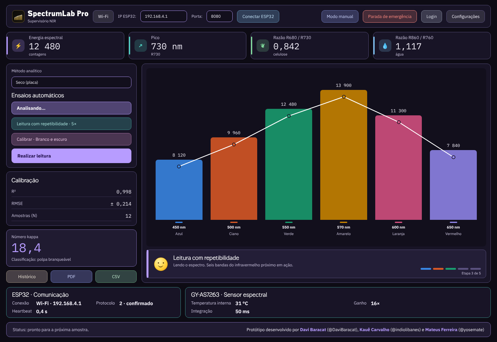
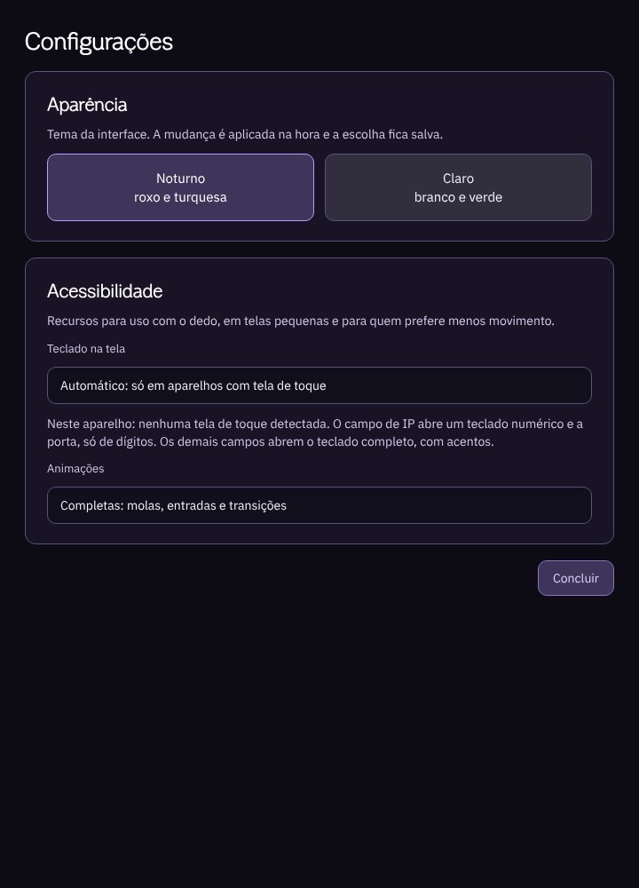

# Identidade visual — SPECTRUM-LAB PRO

Este documento define logos, cores, tipografia, superfícies, cursor e comportamento visual do programa, da documentação e do README. Vale para novas telas e ajustes futuros. A regra de estilo (superfícies planas, cor como informação) está em [`ISA-101.md`](ISA-101.md).

| Configurações · Noturno | Configurações · Claro |
|---|---|
|  |  |

> As imagens são um **espécime em HTML** gerado por `tools/especime.py` a partir das **mesmas paletas e receitas** do programa (`appearance.py` e `glass.py`). Servem para conferir hierarquia, contraste e proporção. **Não são capturas da tela real**: a renderização exata das fontes no Qt só se confirma com o programa aberto (`docs/TUTORIAL_CODESPACE.md`).

## Linguagem de design

Desde a 4.16.2 o programa segue a **ISA-101** (interfaces homem-máquina para automação de processos): superfícies planas e opacas, sem degradê, vidro, brilho ou textura; a cor é informação (estado, alarme) e não enfeite. Detalhes, o que mudou e como conciliamos com os botões coloridos em [`ISA-101.md`](ISA-101.md).

Referências de linguagem, usadas só como inspiração (nunca código ou imagem de terceiros):

- **Clareza da interface da Apple**: poucos elementos por tela, hierarquia tipográfica curta, cantos moderados (10 px nos botões e campos, 12 px nos painéis) e movimento com física de mola. As fontes e o kit visual da Apple são proprietários e não são usados.
- **Material 3** para os estados de toque (realce ao passar, cor viva ao pressionar, ondulação no ponto tocado) e alvos de toque grandes.

O visual "vidro translúcido" das versões 4.15 a 4.16.1 foi retirado: a ISA-101 recomenda evitar gradientes, brilhos e efeitos 3D, que competem com a informação de processo.

**Por que não Jetpack Compose neste programa.** O Compose é uma biblioteca em Kotlin (Android e JVM) e não pode ser embutido em um aplicativo PyQt5. O caminho para Android é um cliente separado, que fale o mesmo protocolo TCP do ESP32 (comandos em `run/fake_esp32.py`), e fica para a última fase do roteiro: primeiro UX/UI, depois animações, por fim Android e talvez web.

## Logos

| Marca | Arquivo | Onde aparece |
|---|---|---|
| SPECTRUM-LAB PRO | `assets/logo/spectrumlab-mark.svg` | Ícone da janela, abertura e **ao lado do nome no cabeçalho** (40 px) |
| SENAI | `assets/brands/senai.svg` | Rodapé da janela (120 × 20 px) e abertura |
| ARAUCO \| Projeto Sucuriú | `assets/brands/arauco-sucuriu.svg` | Rodapé da janela (120 × 20 px) e abertura |
| ARAUCO (wordmark isolado) | `assets/brands/arauco.svg` | Reserva, para uso sem o projeto |

Regras de uso:

- Os SVGs não têm fundo. Use sobre fundo claro ou escuro, sem recolorir a marca.
- Tamanho mínimo: 20 px de altura na tela (logos do rodapé). Abaixo disso, a marca do programa substitui a composta.
- Deixe, em volta de cada logo, um espaço livre igual à altura da letra "a" do wordmark ARAUCO.
- Os logos SENAI e ARAUCO são de terceiros. O uso no executável e na documentação depende de autorização (auditoria, item B8).

## Assinatura

> Protótipo desenvolvido por Davi Baracat, Kauê Carvalho e Mateus Ferreira

Aparece na abertura (canto inferior direito) e no **rodapé da janela principal**. Cada autor é um link para o seu GitHub: **Davi Baracat** → `github.com/DaviBaracat` (@DaviBaracat), **Kauê Carvalho** → `github.com/indiolibanes` e **Mateus Ferreira** → `github.com/yosemate`. Os nomes e os links estão em `version.py` (`__authors__` e `__author_links__`; `credits_html()` monta o texto), em um só lugar. A cor do link é a cor de link da paleta do tema (destaque).

## Temas

Há dois temas, escolhidos em *Configurações → Aparência*; a escolha fica salva e a troca acontece em uma fusão suave de cerca de 360 ms (sem ela, com *Reduzir animações*). *Acessibilidade* é uma seção à parte, com o teclado na tela e as animações. Preferências antigas (`dark`, `gold`, `umber`) migram sozinhas para o tema Noturno.

### Noturno · roxo e turquesa (padrão)

Fundo quase preto com um leve tom violeta, superfícies lisas e sem textura. **Roxo** é a cor de identidade (botão principal, seleção, números de destaque); **turquesa** é a cor secundária (dados e calibração, borda dos cartões de comunicação e sensor). Os dois ficam longe dos matizes de alarme (vermelho, laranja, amarelo), para que um alarme nunca se confunda com decoração. Por que turquesa: é o oposto do roxo no círculo cromático (contraste forte sem competir), não é cor de alarme e passa o contraste mínimo sobre o fundo escuro.

| Token | Hex | Uso |
|---|---|---|
| canvas | `#0D0B14` | Fundo da janela |
| surface | `#181426` | Painéis e diálogos |
| soft | `#231E37` | Áreas alternadas e indicador de análise |
| border | `#5B5280` | Bordas sólidas e divisores |
| text | `#F4F1FB` | Texto principal |
| heading | `#FFFFFF` | Títulos |
| muted | `#D2CBE6` | Texto secundário |
| disabled | `#8F88AB` | Controles desabilitados |
| accent | `#B79CFF` | Roxo: ação principal, destaque |
| secondary | `#4FD1C1` | Turquesa: dados e calibração |
| positive / warning / danger | `#7FD99A` / `#F0B24B` / `#FF8A80` | Normal / aviso / alarme (reservadas) |
| sky / violet (índigo) / rose (orquídea) | `#7CC4F2` / `#93A6FF` / `#E89CDA` | Tons de função dos botões e ícones |
| slate / sand | `#AEB8CC` / `#D6C6A8` | Tons neutros de função |
| on_strong | `#1C0B45` | Texto sobre botão roxo |

### Claro · branco e verde

| Token | Hex | Uso |
|---|---|---|
| canvas | `#F4F6F1` | Fundo da janela |
| surface | `#FFFFFF` | Cartões e diálogos |
| soft | `#E8EEE2` | Áreas alternadas |
| border | `#B3C0A8` | Bordas e divisores |
| text / heading / muted | `#142009` / `#1B2E10` / `#44523A` | Texto |
| disabled | `#7E8873` | Controles desabilitados |
| accent | `#436722` | Verde: ação principal |
| secondary | `#0F6E66` | Turquesa escuro |
| positive / warning / danger | `#266435` / `#8A5A00` / `#B3261E` | Normal / aviso / alarme (reservadas) |
| sky / violet (índigo) / rose (orquídea) | `#1F6FA8` / `#4B55C8` / `#A03C8E` | Tons de função |
| slate / sand | `#4A5568` / `#6A5F52` | Tons neutros de função |
| on_strong | `#FFFFFF` | Texto sobre botão verde |

**Origem do verde.** Não há manual de marca da Arauco no repositório. O verde foi derivado do logo *ARAUCO | Projeto Sucuriú* (matiz das colinas, cerca de 92°) e escurecido para dar contraste. **Se houver o manual oficial, troque `accent` e `accent_strong` em `appearance.py`** e o resto do tema acompanha.

**Contrastes (WCAG, conferidos em `tests/test_glass.py`).** Texto sobre fundo e sobre painel acima de 14:1; texto secundário acima de 7:1; destaque sobre fundo e cada tom de função sobre o painel acima de 4,5:1; texto do botão em tom sobre o próprio preenchimento acima de 4,5:1. Controles desabilitados ficam perto de 3,5:1 de propósito.

## Cores por função e por série

Padrão de cor dos botões (um matiz por função, sempre o mesmo; nenhum usa vermelho, laranja ou amarelo):

| Botão | Tom | Observação |
|---|---|---|
| Realizar leitura | accent (cheio) | Única ação principal da tela |
| Leitura com repetibilidade · 5× | secondary | |
| Calibrar · Branco e escuro | rose | |
| Conectar ESP32 | sky | |
| Modo manual | indigo | |
| Login | slate | |
| Histórico | sand | |
| PDF | indigo | Exportação |
| CSV | green | Exportação |
| Console de telemetria | slate | |
| Parada de emergência | danger (vermelho) | Única cor de alarme em um botão |

As receitas (`tone_fill`, `tone_text`, `tone_border`, `tone_hot`) estão em `glass.py`; o preenchimento é sólido e o texto usa a cor do tom, com contraste conferido nos testes.

- **Gráficos** usam uma cor por banda espectral, sempre na mesma ordem (`appearance.SERIES`): noturno `#3987E5 #D95926 #199E70 #C98500 #D55181 #9085E9`; claro `#2A78D6 #EB6834 #1BAF7A #EDA100 #E87BA4 #6250D6`. São cores de **dados**, não de estado, e vêm sempre com o rótulo da banda (nome e comprimento de onda) e uma tarja ao lado, para a leitura nunca depender só da cor.
- A curva espectral usa a cor de títulos do tema, com área lisa e discreta, e um ponto por banda na cor da banda. Barras lisas, sem degradê.

## Superfícies

Receitas em `glass.py` (sem Qt, testadas). O nome do módulo é herança do visual anterior; hoje tudo é plano:

| Elemento | Receita |
|---|---|
| Painel | Cor `surface` sólida, borda de 1 px (`border`), raio 12 px |
| Cartão de resultado e rodapé | `surface` com 4–5% do destaque, borda no tom do destaque |
| Cartões de comunicação e sensor | Painel com borda turquesa (`secondary`), fonte maior: são os dados mais importantes depois do gráfico |
| Botão secundário | Cinza sólido (11% de branco sobre a superfície, no noturno); ao passar o mouse clareia e a borda vira destaque |
| Botão em tom | Superfície tingida com a cor da função (24% no noturno), borda no tom, sem degradê |
| Botão principal | Cor de destaque cheia e lisa |
| Campos | Poço mais fundo que o painel, borda de destaque no foco |
| Fundo | Cor do tema, lisa. Sem textura, sem brilho ambiente |

Diálogos e painéis usam a mesma cor sólida.

## Tipografia

Quatro famílias, embutidas em `assets/fonts/`; o programa as carrega na abertura, então a aparência é igual no Windows, no Linux e no executável.

| Família | Função | Licença |
|---|---|---|
| **Arena** | Marca: o nome "SpectrumLab Pro" no cabeçalho. Não tem dígitos nem acentos: só serve para o nome | Não documentada (ver abaixo) |
| **Dropline** | Títulos e cabeçalhos de seção. Cobre acentos e dígitos; só existe em peso regular (por isso nunca é pedida em negrito) | Não documentada (ver abaixo) |
| **IBM Plex Sans** | Interface: rótulos, botões, texto corrido | SIL OFL |
| **IBM Plex Mono** | Valores de medição (KPIs, número kappa, eixos, console), largura fixa | SIL OFL |

A EB Garamond, usada antes nos títulos, saiu da interface. Os arquivos *Evershore* e *The Heritage Legacy Fancy Logo*, enviados junto, são decorativos (letras de exibição) e **não são usados** na interface operacional.

**Aviso de licença.** Os arquivos Arena, Dropline, Evershore e Heritage não trazem licença legível, e o repositório é público. A Evershore declara `fsType 4` (incorporação só para visualização/impressão). Antes de distribuir o executável ou publicar o repositório com essas fontes, confirme os direitos de uso com a origem delas; se não houver permissão, basta trocar `FAMILY_BRAND` e `FAMILY_DISPLAY` em `typography.py` (o resto do programa usa os papéis, não os nomes).

Só os pesos **400 e 700** são usados nas Plex: são os que Windows, macOS e Linux agrupam na mesma família sem ambiguidade. A Dropline e a Arena só têm o regular: o QSS normalizado remove o negrito delas para o Qt não "engrossar" o desenho. A Dropline não tem alguns sinais (`·`, `…`, `–`): a pilha de fontes cai para a Plex Sans nesses caracteres.

Se uma fonte não carregar, o programa usa Segoe UI / Consolas (nessa ordem de preferência por papel).

### Escala (pixels, a 100%)

| Papel | Tamanho | Família · peso | Uso |
|---|---|---|---|
| display | 44 | Dropline 400 | Só na abertura |
| hero | 40 | Mono 400 | Número kappa |
| kpi | 28 | Mono 400 | Valor dos indicadores |
| brand | 24 | Arena 400 | Nome "SpectrumLab Pro" no cabeçalho |
| title | 24 | Dropline 400 | Títulos de diálogo |
| section | 20 | Dropline 400 | Títulos de painel e do indicador de análise |
| button | 16 | Sans 700 | Botão principal e Concluir do teclado |
| card | 14 | Sans 400 | Título de cartão, botões |
| body | 14 | Sans 400 | Texto corrido, campos |
| label | 12 | Sans 400 | Rótulos pequenos |
| caption | 12 | Sans 400 | Legendas e apoio |
| data | 14 | Mono 400 | Tabelas e console |

Regras:

1. A escala é 12, 14, 16, 20, 24, 28 e 40 px (44 só na abertura). O mínimo é 12 px: nada fica menor, e tamanhos antigos de 9 a 11 px sobem para 12.
2. Cada painel usa no máximo quatro tamanhos.
3. Cada tela tem um único destaque.
4. Números de medição sempre em Mono.
5. O QSS do Qt **ignora** `line-height` e `letter-spacing`; por isso o programa não os usa.

**Como é aplicado.** `typography.py` define a escala. Toda folha de estilo que passa pelo gerenciador de temas é normalizada: tamanhos vão ao degrau mais próximo, pesos aos disponíveis (400 ou 700), famílias antigas (Segoe UI, Bahnschrift, Georgia, Consolas) à família do mesmo papel, e `line-height`/`letter-spacing` são removidos. Assim, telas antigas seguem a escala sem reescrita. Novos widgets devem usar `typography.qss("papel")`.

## Responsividade

A janela se adapta a qualquer tela, sem encolher o texto:

- O painel é um canvas que **acompanha o tamanho da janela** e é ampliado ou reduzido só um pouco (escala entre 0,90 e 1,35, nunca abaixo do que o layout precisa). A lógica está em `responsive_math.py` (pura, com testes) e em `responsive_layout.py`.
- Quando falta largura, o **layout se reorganiza**: o cabeçalho passa para duas linhas abaixo de ~1590 px lógicos, os quatro indicadores viram uma grade 2×2 abaixo de ~1180 px e os painéis se empilham em tela vertical ou abaixo de ~1040 px.
- A coluna da esquerda (método, ensaios, calibração, resultado) fica numa **área rolável**: os cartões mantêm a altura natural e o texto nunca é comprimido; se não couber, rola.
- O cartão de calibração mostra R², RMSE e N em **linhas** (rótulo à esquerda, valor à direita), em vez de três caixas estreitas lado a lado, que era o que comprimia o texto.

## Cursor

O cursor do mouse é uma **seta de fibra de celulose**: corpo cor de papel, contorno escuro, um fio de luz claro para ler sobre o fundo escuro e fibras soltas na cauda. Sobre botões, listas e abas vira uma seta de destaque com o mesmo desenho (`assets/cursors/fibra-seta*.png` e `fibra-mao*.png`, em 32 px e 64 px para telas HiDPI). Campos de texto mantêm o cursor "I" do sistema, que indica onde se digita.

Os desenhos são gerados por `tools/gerar_assets.py`. A instalação está em `cursors.py` (um filtro de eventos da aplicação). Para voltar ao cursor do sistema: variável de ambiente `SPECTRUM_SYSTEM_CURSOR=1`.

## Botões e animações

Inspiração: movimento da Apple (molas com amortecimento, entradas escalonadas, fusões), sem copiar assets. As curvas estão em `animation_math.py` (`spring`, `ease_out_expo`, `staggered`; puras e testadas) e o que o QSS não anima fica em `button_fx.py` e `motion.py`.

| Elemento | Efeito |
|---|---|
| Botão em repouso | Sólido e liso; botões em tom, tingidos pela função |
| Passar o mouse/dedo | Borda realçada e leve clareamento (180 ms); sem reflexos |
| Pressionado | O botão "cede": escurecimento nas bordas e profundidade, com **mola** (320 ms) e ondulação (620 ms) a partir do ponto tocado |
| Soltar | Volta com **leve ultrapassagem** e um anel que se dissipa (900 ms) |
| Em andamento | Vira "Analisando…" com uma faixa suave que percorre o botão |
| Desabilitado | Cinza apagado, texto cinza do tema, sem efeito |
| Abertura da janela | Painéis entram em sequência (atraso de 70 ms entre eles, 750 ms cada) com subida e fusão |
| Troca de tema | Fusão de ~360 ms entre a imagem antiga e a nova |
| Diálogos | Surgem com fusão de 200 ms |
| Barras do gráfico | Sobem em 850 ms com mola (ultrapassagem leve) |

O efeito de pressão é **só pintura**: não muda o tamanho do botão. Escalar a geometria foi descartado porque faz o layout se mexer e perde toques na borda.

**Reduzir animações.** Em *Configurações → Acessibilidade → Animações* (ou `SPECTRUM_REDUCE_MOTION=1`) ficam só a troca de estado dos botões; molas, entradas, fusões e a subida das barras são desligadas.

## Indicador de análise

Abaixo do gráfico, o `AnalysisIndicator` mostra o que o equipamento faz, em linguagem simples:

- **Rosto colorido** desenhado em vetor (`emoji_icons.py`; amarelo com brilho, ficando laranja com gota de suor no alerta): sorri em repouso e ao concluir, pisca de tempos em tempos, dá um pulinho com faíscas coloridas quando a análise termina e fica preocupado em falha ou emergência. É desenhado em vez de usar emoji de texto porque o tema remove emojis de texto e as fontes de emoji colorido variam entre sistemas.
- **Título e frase** que se alternam a cada 4,5 s (`analysis_messages.py`, textos em português do Brasil).
- **Espectro animado** durante a leitura e **etapas 1 a 5**, cada etapa concluída na cor da sua banda (fechar gaveta, avançar sensor, ler, recuar sensor, abrir gaveta).
- **Mensagem final** "Análise concluída. Boa amostra!" por 7 s.

## Teclado na tela

Para touchscreen, ao tocar em um campo de texto abre um teclado próprio (`touch_keyboard.py`), com o mesmo estilo plano dos botões:

- **Quando abre.** Só em aparelhos de toque. O programa reconhece sozinho se o aparelho tem tela de toque (`QTouchDevice`) ou se é uma plataforma móvel (Android/iOS). Em computador com mouse, o teclado **não abre**, nem ao iniciar um teste. Em *Configurações → Acessibilidade → Teclado na tela* há três modos: **Automático** (padrão), **Sempre** e **Nunca**; a tela mostra o que foi detectado neste aparelho. A variável `SPECTRUM_TOUCH=1` (ou `0`) força o resultado, útil em testes.
- **Tamanho e lugar.** Menor que antes (numérico 300 × 248 px; completo até 660 × 292 px) e no **canto superior esquerdo** da janela. Só sai de lá se cobrir o campo em edição; nesse caso vai para baixo ou ao lado do campo.
- **Numérico** (dígitos e ponto) no campo de IP; **só dígitos** na porta. **Completo** (letras, símbolos e acentos do português) nos demais campos, como login e nomes de amostra.
- Não rouba o foco: o cursor continua no campo e as teclas chegam como as do teclado físico. Funciona dentro de diálogos modais.

Para um campo novo escolher o teclado: `campo.setProperty("touchKeyboard", "numeric")` (ou `"digits"` / `"off"`).

## Estado da aplicação

Aplicado: abertura, painel principal (cabeçalho com logo, indicadores compactos, coluna rolável, gráfico, cartões de comunicação e sensor em destaque, rodapé reduzido), cartões KPI, diálogos (via normalização), Configurações em duas seções, campos de IP, teclado, indicador, cursor, animações.

**Não verificado com o programa em execução.** Esta revisão foi escrita sem PyQt5 disponível no ambiente de desenvolvimento do assistente: a lógica pura tem testes (`tests/`), e há um teste gráfico (`tests/test_gui_smoke.py`) para rodar no Codespace, mas o resultado visual real precisa ser conferido pelo roteiro de `docs/TUTORIAL_CODESPACE.md`.
