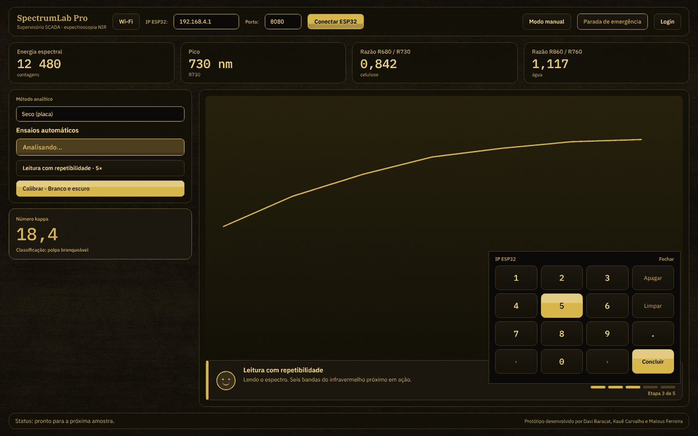
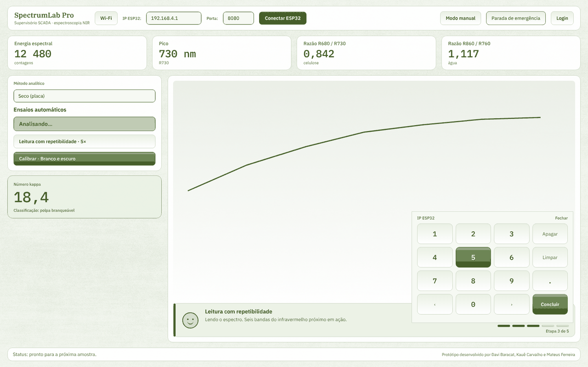

# Identidade visual — SPECTRUM-LAB PRO

Este documento define logos, cores, tipografia e comportamento visual do programa, da documentação e do README. Vale para novas telas e ajustes futuros.

> As duas imagens acima são um **especímen em HTML** feito com as mesmas cores, fontes e proporções do programa, para conferir hierarquia e contraste. **Não são capturas da tela real.** Capturas do programa em execução entram aqui depois do teste no Codespace (`docs/TUTORIAL_CODESPACE.md`).

## Linguagem de design

A interface segue a linguagem **Material 3** (a mesma que o Jetpack Compose implementa), escrita em Qt: superfícies tonais em vez de caixas com sombra pesada, estados de toque (realce ao passar, cor viva ao pressionar, ondulação no ponto tocado), alvos de toque grandes e uma hierarquia tipográfica curta.

**Por que não Jetpack Compose.** O Compose é uma biblioteca em Kotlin (Android e JVM) e não pode ser embutido em um aplicativo PyQt5. Usá-lo exigiria reescrever o supervisório em Kotlin. Se a equipe quiser um aplicativo Compose de verdade (por exemplo, um painel Android para tablet), o caminho é um cliente separado que fale o mesmo protocolo TCP do ESP32 (os comandos estão em `run/fake_esp32.py`), mantendo este programa como supervisório da bancada.

## Logos

| Marca | Arquivo | Onde aparece |
|---|---|---|
| SPECTRUM-LAB PRO | `assets/logo/spectrumlab-mark.svg` | Ícone da janela e abertura |
| SENAI | `assets/brands/senai.svg` | Rodapé da janela e abertura |
| ARAUCO \| Projeto Sucuriú | `assets/brands/arauco-sucuriu.svg` | Rodapé da janela e abertura |
| ARAUCO (wordmark isolado) | `assets/brands/arauco.svg` | Reserva, para uso sem o projeto |

Regras de uso:

- Os SVGs não têm fundo. Use sobre fundo claro ou escuro, sem recolorir a marca.
- Tamanho mínimo: 24 px de altura na tela. Abaixo disso, a marca do programa substitui a composta.
- Deixe, em volta de cada logo, um espaço livre igual à altura da letra "a" do wordmark ARAUCO.
- Os logos SENAI e ARAUCO são de terceiros. O uso no executável e na documentação depende de autorização (auditoria, item B8).

## Assinatura

> Protótipo desenvolvido por Davi Baracat, Kauê Carvalho e Mateus Ferreira

Aparece na abertura (canto inferior direito) e no rodapé da janela principal. O texto está em `version.py` (`__credits__` e `__authors__`), em um só lugar.

## Temas

Há dois temas, escolhidos em *Configurações → Aparência*; a escolha fica salva. O tema escuro azul antigo foi removido: quem o tinha salvo passa a usar o Ouro automaticamente.

### Ouro (escuro, padrão): preto e dourado

| Token | Hex | Uso |
|---|---|---|
| canvas | `#0B0A08` | Fundo da janela (preto quente) |
| surface | `#131108` | Cartões e painéis |
| soft | `#1C1810` | Áreas alternadas e botões |
| border | `#4A3D22` | Bordas e divisores |
| text | `#F4EAD2` | Texto principal (marfim) |
| muted | `#BFAE86` | Texto secundário |
| disabled | `#6F6548` | Controles desabilitados |
| accent | `#D4AF37` | Títulos, números de destaque e detalhes dourados |
| positive / warning / danger | `#B9D98A` / `#E8C25A` / `#E97462` | Estado OK / atenção / erro |
| on_strong | `#0B0A08` | Texto sobre botão dourado |

### Claro: branco e verde

| Token | Hex | Uso |
|---|---|---|
| canvas | `#F6F9F3` | Fundo da janela (branco com um fio de verde) |
| surface | `#FFFFFF` | Cartões e painéis |
| soft | `#EAF1E4` | Áreas alternadas e botões |
| border | `#CBD6C2` | Bordas e divisores |
| text | `#1B2612` | Texto principal |
| muted | `#56634B` | Texto secundário |
| disabled | `#7E8873` | Controles desabilitados |
| accent | `#436722` | Verde de destaque e botão primário |
| positive / warning / danger | `#266435` / `#8A5A00` / `#B3261E` | Estado OK / atenção / erro |
| on_strong | `#FFFFFF` | Texto sobre botão verde |

**Origem do verde.** Não há manual de marca da Arauco no repositório. O verde foi derivado do logo *ARAUCO | Projeto Sucuriú* (matiz das colinas, cerca de 92°) e escurecido para dar contraste. **Se houver o manual oficial, troque `accent` e `accent_strong` em `appearance.py`** e o resto do tema acompanha.

Contrastes (WCAG): texto sobre fundo acima de 14:1 nos dois temas; texto secundário acima de 6:1; texto do botão primário acima de 6,5:1; destaque sobre cartão acima de 6,5:1. Controles desabilitados ficam abaixo de 4,5:1 de propósito.

**Textura de celulose.** O fundo da janela principal leva uma textura de fibras quase transparente: `assets/textures/celulose-madeira.png` (âmbar, tema Ouro) e `assets/textures/celulose-claro.png` (verde-musgo, tema Claro). Os cartões são 92% opacos, então a textura aparece nas margens e levemente por trás dos painéis. Diálogos mantêm cor sólida.

## Tipografia

Superfamília **IBM Plex** (licença SIL OFL), embutida em `assets/fonts/`. O programa carrega as fontes na abertura, então a aparência é igual no Windows, no Linux e no executável, sem instalar nada. Licença em `assets/fonts/LICENSE-IBM-Plex-OFL.txt`.

| Família | Função |
|---|---|
| **IBM Plex Sans** | Interface: rótulos, botões, texto corrido |
| **IBM Plex Serif** | Marca e títulos |
| **IBM Plex Mono** | Valores de medição (KPIs, número kappa, eixos do gráfico, console), com largura fixa para alinhar |

Se uma fonte não carregar, o programa usa Segoe UI / Georgia / Consolas (nessa ordem de preferência por papel).

### Escala (pixels, a 100%)

| Papel | Tamanho | Família · peso | Uso |
|---|---|---|---|
| display | 44 | Serif 600 | Só na abertura |
| hero | 40 | Mono 500 | Número kappa |
| kpi | 28 | Mono 500 | Valor dos indicadores |
| title | 19 | Serif 600 | Marca no cabeçalho, títulos de diálogo |
| section | 15 | Sans 600 | Títulos de painel, botão primário |
| card | 13 | Sans 500 | Título de cartão, botões |
| body | 13 | Sans 400 | Texto corrido, campos |
| label | 11 | Sans 500 | Rótulos pequenos |
| caption | 11 | Sans 400 | Legendas e apoio |
| data | 13 | Mono 400 | Tabelas e console |

Regras:

1. O mínimo é 11 px. Nada fica menor.
2. Cada painel usa no máximo quatro tamanhos.
3. Cada tela tem um único destaque.
4. Números de medição sempre em Mono.
5. O QSS do Qt **ignora** `line-height` e `letter-spacing`; por isso o programa não os usa (a versão anterior deste documento citava espaçamento de letras, o que não tinha efeito).

**Como é aplicado.** `typography.py` define a escala. Toda folha de estilo que passa pelo gerenciador de temas é normalizada: tamanhos vão ao degrau mais próximo, pesos aos disponíveis, famílias antigas (Segoe UI, Bahnschrift, Consolas) à família Plex do mesmo papel, e `line-height`/`letter-spacing` são removidos. Assim, telas antigas seguem a escala sem reescrita. Novos widgets devem usar `typography.qss("papel")`.

## Botões e animações

| Estado | Efeito |
|---|---|
| Repouso | Gradiente vertical sutil (botão primário: dourado ou verde) |
| Passar o mouse/dedo | Borda de destaque e realce que surge suavemente (140 ms) |
| Pressionado | Gradiente mais claro e cor viva do tema, com ondulação (520 ms) a partir do ponto tocado |
| Em andamento | O botão que iniciou o ciclo vira "Analisando…" com um brilho que percorre o botão |
| Desabilitado | Cinza do tema, sem efeito |

Implementação: o gradiente e a cor de pressionado ficam no QSS; `button_fx.py` acrescenta o que o QSS não anima (realce, ondulação e brilho) com uma camada transparente por cima de cada botão.

## Indicador de análise

Abaixo do gráfico, o `AnalysisIndicator` mostra o que o equipamento faz, em linguagem simples:

- **Rosto** desenhado (sem emoji): sorri em repouso e ao concluir, pisca de tempos em tempos, dá um pulinho com faíscas quando a análise termina e fica sério em falha ou emergência.
- **Título e frase** que se alternam a cada 4,5 s (`analysis_messages.py`, textos em português do Brasil).
- **Espectro animado** durante a leitura e **etapas 1 a 5** (fechar gaveta, avançar sensor, ler, recuar sensor, abrir gaveta).
- **Mensagem final** "Análise concluída. Boa amostra!" por 7 s.

## Teclado na tela

Para touchscreen, ao tocar em um campo de texto abre um teclado próprio (`touch_keyboard.py`):

- **Numérico** (dígitos e ponto) no campo de IP; **só dígitos** na porta.
- **Completo** (letras, símbolos e acentos do português) nos demais campos, como login e nomes de amostra.
- Não rouba o foco: o cursor continua no campo e as teclas chegam como as do teclado físico.
- Posiciona-se onde não cubra o campo em edição e funciona dentro de diálogos modais.
- Liga e desliga em *Configurações → Aparência* (padrão: ligado).

Para um campo novo escolher o teclado: `campo.setProperty("touchKeyboard", "numeric")` (ou `"digits"` / `"off"`).

## Estado da aplicação

Aplicado: abertura, painel principal, cartões KPI, gráficos, diálogos (via normalização), campos de IP e teclado.

**Não verificado com o programa em execução.** Esta revisão foi escrita sem PyQt5 disponível no ambiente de desenvolvimento do assistente: a lógica pura tem testes (`tests/`), e há um teste gráfico (`tests/test_gui_smoke.py`) para rodar no Codespace, mas o resultado visual real precisa ser conferido pelo roteiro de `docs/TUTORIAL_CODESPACE.md`.
