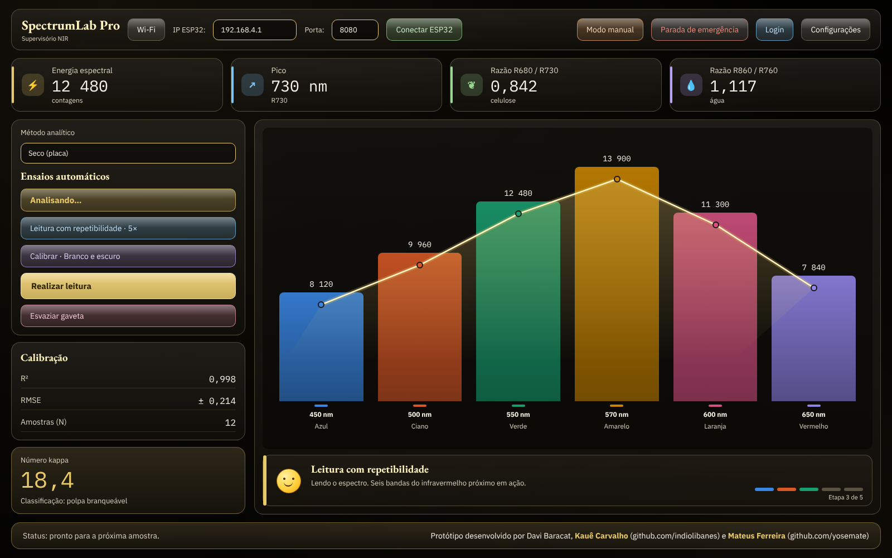
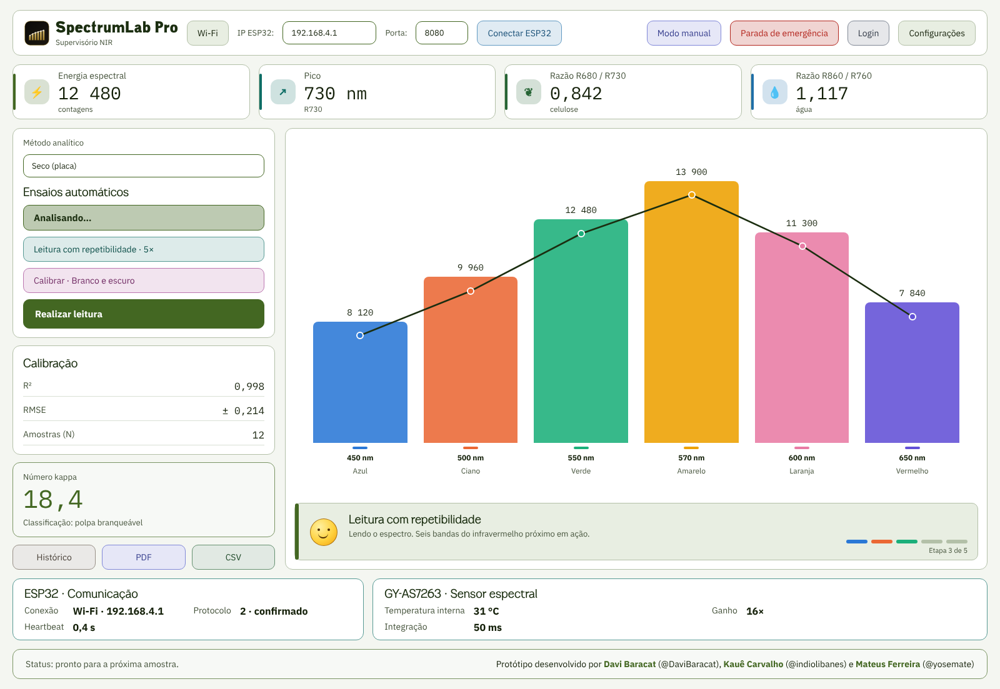
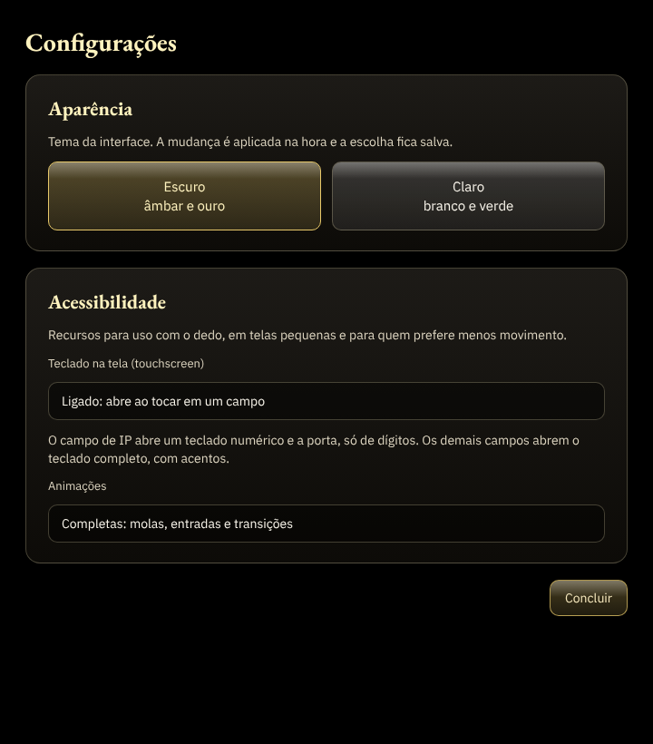
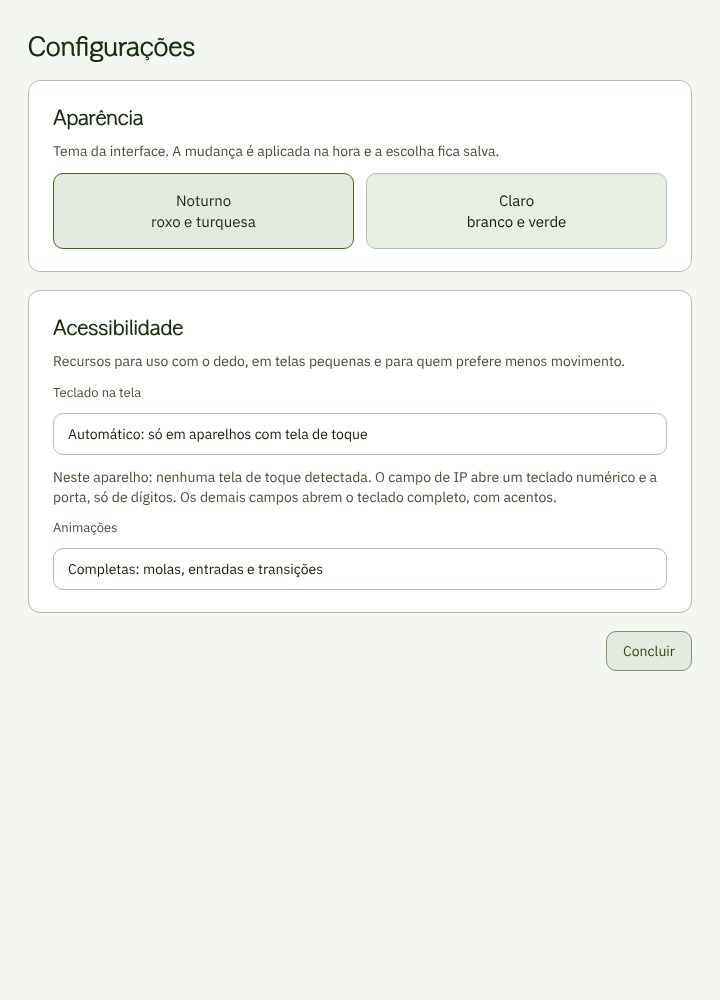

# Identidade visual — SPECTRUM-LAB PRO

Este documento define logos, cores, tipografia, vidro, cursor e comportamento visual do programa, da documentação e do README. Vale para novas telas e ajustes futuros.

| Configurações · Escuro | Configurações · Claro |
|---|---|
|  |  |

> As imagens são um **espécime em HTML** gerado por `tools/especime.py` a partir das **mesmas paletas e receitas de vidro** do programa (`appearance.py` e `glass.py`). Servem para conferir hierarquia, contraste e proporção. **Não são capturas da tela real**: o desfoque de fundo e a renderização exata das fontes no Qt só se confirmam com o programa aberto (`docs/TUTORIAL_CODESPACE.md`).

## Linguagem de design

Três referências, todas usadas como inspiração de linguagem, nunca como cópia de código ou de imagem:

- **Vidro translúcido** (superfícies que deixam o fundo aparecer, com um fio de luz na borda). Ponto de partida: o visual do app BitChord, que é licenciado em GPL-3.0; por isso **nenhum código nem recurso dele** foi copiado, só a ideia (cartões flutuantes, translucidez, realce de borda).
- **Clareza da interface da Apple**: poucos elementos por tela, hierarquia tipográfica curta, cantos generosos (10 px nos botões e campos, 16 px nos painéis), destaque dourado (ou verde) para a ação principal e um tom por função nos demais botões, movimento com física de mola (entrada escalonada, botões que cedem ao toque e voltam com leve ultrapassagem, troca de tema em fusão). Só a *linguagem*: as fontes e o kit visual da Apple são proprietários e não são usados.
- **Material 3** para os estados de toque (realce ao passar, cor viva ao pressionar, ondulação no ponto tocado) e alvos de toque grandes.

**O que o Qt não faz.** O QSS não desfoca o que está atrás do widget. O vidro é construído com preenchimento translúcido em degradê, fio de luz na borda, a textura do fundo (no claro) aparecendo por baixo dos painéis e um brilho ambiente pintado no fundo. Resultado: a mesma sensação de profundidade, sem desfoque real.

**Por que não Jetpack Compose neste programa.** O Compose é uma biblioteca em Kotlin (Android e JVM) e não pode ser embutido em um aplicativo PyQt5. O caminho para Android é um cliente separado, que fale o mesmo protocolo TCP do ESP32 (comandos em `run/fake_esp32.py`), e fica para a última fase do roteiro: primeiro UX/UI, depois animações, por fim Android e talvez web.

## Logos

| Marca | Arquivo | Onde aparece |
|---|---|---|
| SPECTRUM-LAB PRO | `assets/logo/spectrumlab-mark.svg` | Ícone da janela e abertura |
| SENAI | `assets/brands/senai.svg` | Rodapé da janela e abertura |
| ARAUCO \| Projeto Sucuriú | `assets/brands/arauco-sucuriu.svg` | Rodapé da janela e abertura |
| ARAUCO (wordmark isolado) | `assets/brands/arauco.svg` | Reserva, para uso sem o projeto |

Regras de uso:

- Os SVGs não têm fundo. Use sobre fundo claro ou escuro, sem recolorir a marca.
- Tamanho mínimo: 24 px de altura na tela. Abaixo disso, a marca do programa substitui a composta.
- Deixe, em volta de cada logo, um espaço livre igual à altura da letra "a" do wordmark ARAUCO.
- Os logos SENAI e ARAUCO são de terceiros. O uso no executável e na documentação depende de autorização (auditoria, item B8).

## Assinatura

> Protótipo desenvolvido por Davi Baracat, Kauê Carvalho e Mateus Ferreira

Aparece na abertura (canto inferior direito) e no **rodapé da janela principal**, que é um cartão de destaque (borda dourada ou verde, texto no contraste do tema). Cada autor é um link para o seu GitHub: **Kauê Carvalho** → `github.com/indiolibanes` e **Mateus Ferreira** → `github.com/yosemate`. Os nomes e os links estão em `version.py` (`__authors__` e `__author_links__`; `credits_html()` monta o texto), em um só lugar. Davi Baracat aparece sem link porque o endereço dele ainda não foi informado: basta acrescentá-lo em `__author_links__`.

## Temas

Há dois temas, escolhidos em *Configurações → Aparência*; a escolha fica salva e a troca acontece em uma fusão suave de cerca de 360 ms (sem ela, com *Reduzir animações*). *Acessibilidade* é uma seção à parte, com o teclado na tela e as animações. Preferências antigas (`dark`, `gold`) migram sozinhas para o tema Escuro.

### Escuro · preto e dourado (padrão)

Preto AMOLED (`#000000`: os pixels ficam totalmente apagados em telas OLED), sem textura, com o dourado como única cor de destaque. Os tons de texto são papel quente, para não parecer frio.

| Token | Hex | Uso |
|---|---|---|
| canvas | `#000000` | Fundo da janela (preto AMOLED, sem textura) |
| surface | `#17140E` | Diálogos e base dos painéis de vidro |
| soft | `#221E15` | Áreas alternadas |
| border | `#5A5342` | Bordas sólidas e divisores |
| text | `#F8F4EA` | Texto principal (papel), 17:1 sobre o fundo |
| heading | `#FFF3BF` | Títulos (ouro pálido) |
| muted | `#DDD5C0` | Texto secundário, 13:1 sobre o fundo |
| disabled | `#8A836C` | Controles desabilitados |
| accent | `#E8C96A` | Destaque: botão principal, números, curva |
| positive / warning / danger | `#9AD68F` / `#F0A965` / `#F58B7E` | Estado OK / atenção / erro |
| sky / violet / rose | `#7CC4F2` / `#B9A2F2` / `#F29BB8` | Tons de função dos botões e dos ícones |
| on_strong | `#2B2200` | Texto sobre botão dourado |

**Sem textura no escuro.** A textura de madeira foi removida: o fundo é preto liso, e o destaque vem do dourado (botão principal, números, curva e bordas), não de ornamento.

### Claro: branco e verde

| Token | Hex | Uso |
|---|---|---|
| canvas | `#F6F9F3` | Fundo da janela (branco com um fio de verde) |
| surface | `#FFFFFF` | Cartões e diálogos |
| soft | `#EAF1E4` | Áreas alternadas |
| border | `#B9C6AE` | Bordas e divisores |
| text | `#142009` | Texto principal |
| heading | `#1B2E10` | Títulos |
| muted | `#44523A` | Texto secundário |
| disabled | `#7E8873` | Controles desabilitados |
| accent | `#436722` | Verde de destaque e botão primário |
| positive / warning / danger | `#266435` / `#8A5A00` / `#B3261E` | Estado OK / atenção / erro |
| sky / violet / rose | `#1F6FA8` / `#6A4BC2` / `#B03A6B` | Tons de função dos botões e dos ícones |
| on_strong | `#FFFFFF` | Texto sobre botão verde |

**Textura de celulose.** `assets/textures/celulose-claro.png`: fibras verde-musgo quase transparentes.

**Origem do verde.** Não há manual de marca da Arauco no repositório. O verde foi derivado do logo *ARAUCO | Projeto Sucuriú* (matiz das colinas, cerca de 92°) e escurecido para dar contraste. **Se houver o manual oficial, troque `accent` e `accent_strong` em `appearance.py`** e o resto do tema acompanha.

**Contrastes (WCAG, conferidos em `tests/test_glass.py`).** Escuro: texto sobre fundo 18:1 e secundário sobre cartão 12:1. Claro: texto sobre fundo acima de 14:1; texto secundário sobre cartão acima de 6:1; destaque sobre fundo acima de 6:1; texto do botão principal e do botão de perigo acima de 4,5:1. Controles desabilitados ficam perto de 3,5:1 de propósito.

## Cores por função e por série

- **Botões** têm um tom por função: dourado/verde (principal), azul-céu (ler e conectar), violeta (calibrar), rosa (esvaziar e limpar), verde (conectar), âmbar (modo manual) e vermelho (emergência). O tom aparece como vidro tingido, borda do tom e texto do tom, e vira cor cheia ao pressionar. As receitas (`tone_fill`, `tone_text`, `tone_border`, `tone_hot`) estão em `glass.py`.
- **Gráficos** usam uma cor por banda espectral, sempre na mesma ordem (`appearance.SERIES`): escuro `#3987E5 #D95926 #199E70 #C98500 #D55181 #9085E9`; claro `#2A78D6 #EB6834 #1BAF7A #EDA100 #E87BA4 #6250D6`. Foram validadas com o validador de paletas (distinção para daltonismo e contraste). O texto do rótulo fica na cor de texto do tema, com uma tarja da cor da banda ao lado, para a leitura nunca depender só da cor.
- A curva espectral usa a cor de títulos do tema, com área suave e halo na cor de destaque, e um ponto por banda na cor da banda.

## Vidro

Receitas em `glass.py` (sem Qt, testadas):

| Elemento | Receita |
|---|---|
| Painel | Degradê vertical translúcido (74% em cima, 56% embaixo no escuro), borda de 1 px com fio de luz (16% de `heading` no escuro, 22% de `accent` no claro), raio 16 px |
| Cartão de resultado | O mesmo vidro com um sopro do tom de destaque e borda de destaque a 38% |
| Botão secundário | Vidro branco a 15% (escuro) com borda de 24% de `heading`, bem visível sobre o fundo preto; ao passar o mouse ganha luz e a borda vira destaque |
| Botão em tom | Vidro tingido com a cor da função (30% no alto, 14% embaixo, no escuro), borda a 70% do tom |
| Botão principal | Cor de destaque cheia, com luz no topo e foco de luz que acompanha o ponteiro (desenhados por `button_fx.py`) |
| Campos | Poço levemente mais escuro que o painel, borda de destaque no foco |
| Fundo | Cor do tema + textura (só no claro) + dois brilhos ambientes (dourado no escuro, verde no claro) |

Diálogos usam cor sólida (são janelas separadas e não há o que enxergar através delas).

## Tipografia

Duas famílias com licença SIL OFL, embutidas em `assets/fonts/`; o programa as carrega na abertura, então a aparência é igual no Windows, no Linux e no executável. Licenças em `assets/fonts/LICENSE-*.txt`.

| Família | Função |
|---|---|
| **EB Garamond** | Títulos e marca: serifa humanista de traço fino, que dá o tom editorial |
| **IBM Plex Sans** | Interface: rótulos, botões, texto corrido |
| **IBM Plex Mono** | Valores de medição (KPIs, número kappa, eixos do gráfico, console), com largura fixa para alinhar |

Só os pesos **400 e 700** são usados: são os que Windows, macOS e Linux agrupam na mesma família sem ambiguidade. Os pesos intermediários (Medium, SemiBold) foram removidos de propósito.

Se uma fonte não carregar, o programa usa Georgia / Segoe UI / Consolas (nessa ordem de preferência por papel).

### Escala (pixels, a 100%)

| Papel | Tamanho | Família · peso | Uso |
|---|---|---|---|
| display | 44 | Garamond 700 | Só na abertura |
| hero | 40 | Mono 400 | Número kappa |
| kpi | 28 | Mono 400 | Valor dos indicadores |
| title | 24 | Garamond 700 | Marca no cabeçalho, títulos de diálogo |
| section | 20 | Garamond 700 | Títulos de painel e do indicador de análise |
| button | 16 | Sans 700 | Botão principal e Concluir do teclado |
| card | 14 | Sans 400 | Título de cartão, botões |
| body | 14 | Sans 400 | Texto corrido, campos |
| label | 12 | Sans 400 | Rótulos pequenos |
| caption | 12 | Sans 400 | Legendas e apoio |
| data | 14 | Mono 400 | Tabelas e console |

Regras:

1. A escala é 12, 14, 16, 20, 24, 28 e 40 px (44 só na abertura). O mínimo é 12 px: nada fica menor, e tamanhos antigos de 9 a 11 px sobem para 12.
2. Cada painel usa no máximo quatro tamanhos.
3. Cada tela tem um único destaque.
4. Números de medição sempre em Mono.
5. O QSS do Qt **ignora** `line-height` e `letter-spacing`; por isso o programa não os usa.

**Como é aplicado.** `typography.py` define a escala. Toda folha de estilo que passa pelo gerenciador de temas é normalizada: tamanhos vão ao degrau mais próximo, pesos aos disponíveis (400 ou 700), famílias antigas (Segoe UI, Bahnschrift, Consolas) à família do mesmo papel, e `line-height`/`letter-spacing` são removidos. Assim, telas antigas seguem a escala sem reescrita. Novos widgets devem usar `typography.qss("papel")`.

## Responsividade

A janela se adapta a qualquer tela, sem encolher o texto:

- O painel é um canvas que **acompanha o tamanho da janela** e é ampliado ou reduzido só um pouco (escala entre 0,90 e 1,35, nunca abaixo do que o layout precisa). A lógica está em `responsive_math.py` (pura, com testes) e em `responsive_layout.py`.
- Quando falta largura, o **layout se reorganiza**: o cabeçalho passa para duas linhas abaixo de ~1590 px lógicos, os quatro indicadores viram uma grade 2×2 abaixo de ~1180 px e os painéis se empilham em tela vertical ou abaixo de ~1040 px.
- A coluna da esquerda (método, ensaios, calibração, resultado) fica numa **área rolável**: os cartões mantêm a altura natural e o texto nunca é comprimido; se não couber, rola.
- O cartão de calibração mostra R², RMSE e N em **linhas** (rótulo à esquerda, valor à direita), em vez de três caixas estreitas lado a lado, que era o que comprimia o texto.

## Cursor

O cursor do mouse é uma **seta de fibra de celulose**: corpo cor de papel, contorno escuro, um fio de luz claro para ler sobre o fundo preto e fibras soltas na cauda. Sobre botões, listas e abas vira uma seta dourada com o mesmo desenho (`assets/cursors/fibra-seta*.png` e `fibra-mao*.png`, em 32 px e 64 px para telas HiDPI). Campos de texto mantêm o cursor "I" do sistema, que indica onde se digita.

Os desenhos são gerados por `tools/gerar_assets.py`. A instalação está em `cursors.py` (um filtro de eventos da aplicação). Para voltar ao cursor do sistema: variável de ambiente `SPECTRUM_SYSTEM_CURSOR=1`.

## Botões e animações

Inspiração: movimento da Apple (molas com amortecimento, entradas escalonadas, fusões), sem copiar assets. As curvas estão em `animation_math.py` (`spring`, `ease_out_expo`, `staggered`; puras e testadas) e o que o QSS não anima fica em `button_fx.py` e `motion.py`.

| Elemento | Efeito |
|---|---|
| Botão em repouso | Vidro com fio de luz no topo; botões em tom, tingidos pela função |
| Passar o mouse/dedo | Borda realçada e um **foco de luz que acompanha o ponteiro** (180 ms) |
| Pressionado | O botão "cede": escurecimento nas bordas e profundidade, com **mola** (320 ms) e ondulação (620 ms) a partir do ponto tocado |
| Soltar | Volta com **leve ultrapassagem** e um anel que se dissipa (900 ms) |
| Em andamento | Vira "Analisando…" com um brilho que percorre o botão |
| Desabilitado | Vidro apagado, texto cinza do tema, sem efeito |
| Abertura da janela | Painéis entram em sequência (atraso de 70 ms entre eles, 750 ms cada) com subida e fusão |
| Troca de tema | Fusão de ~360 ms entre a imagem antiga e a nova |
| Diálogos | Surgem com fusão de 200 ms |
| Barras do gráfico | Sobem em 850 ms com mola (ultrapassagem leve) |

O efeito de pressão é **só pintura**: não muda o tamanho do botão. Escalar a geometria foi descartado porque faz o layout se mexer e perde toques na borda.

**Reduzir animações.** Em *Configurações → Acessibilidade → Animações* (ou `SPECTRUM_REDUCE_MOTION=1`) ficam só a troca de estado dos botões; molas, entradas, fusões e a subida das barras são desligadas.

## Indicador de análise

Abaixo do gráfico, o `AnalysisIndicator` mostra o que o equipamento faz, em linguagem simples:

- **Rosto colorido** desenhado em vetor (`emoji_icons.py`; amarelo com brilho, ficando laranja com gota de suor no alerta): sorri em repouso e ao concluir, pisca de tempos em tempos, dá um pulinho com faíscas coloridas quando a análise termina e fica preocupado em falha ou emergência. É desenhado em vez de usar emoji de texto porque o tema remove emojis de texto e as fontes de emoji colorido variam entre sistemas.
- **Título e frase** que se alternam a cada 4,5 s (`analysis_messages.py`, textos em português do Brasil).
- **Espectro animado** durante a leitura e **etapas 1 a 5**, cada etapa concluída na cor da sua banda (fechar gaveta, avançar sensor, ler, recuar sensor, abrir gaveta).
- **Mensagem final** "Análise concluída. Boa amostra!" por 7 s.

## Teclado na tela

Para touchscreen, ao tocar em um campo de texto abre um teclado próprio (`touch_keyboard.py`), com teclas de vidro e o mesmo destaque dos botões:

- **Numérico** (dígitos e ponto) no campo de IP; **só dígitos** na porta.
- **Completo** (letras, símbolos e acentos do português) nos demais campos, como login e nomes de amostra.
- Não rouba o foco: o cursor continua no campo e as teclas chegam como as do teclado físico.
- Posiciona-se onde não cubra o campo em edição e funciona dentro de diálogos modais.
- Liga e desliga em *Configurações → Acessibilidade* (padrão: ligado).

Para um campo novo escolher o teclado: `campo.setProperty("touchKeyboard", "numeric")` (ou `"digits"` / `"off"`).

## Estado da aplicação

Aplicado: abertura, painel principal (cabeçalho, indicadores com ícones coloridos, coluna rolável, gráfico, rodapé), cartões KPI, diálogos (via normalização), Configurações em duas seções, campos de IP, teclado, indicador, cursor, animações.

**Não verificado com o programa em execução.** Esta revisão foi escrita sem PyQt5 disponível no ambiente de desenvolvimento do assistente: a lógica pura tem testes (`tests/`), e há um teste gráfico (`tests/test_gui_smoke.py`) para rodar no Codespace, mas o resultado visual real precisa ser conferido pelo roteiro de `docs/TUTORIAL_CODESPACE.md`.
